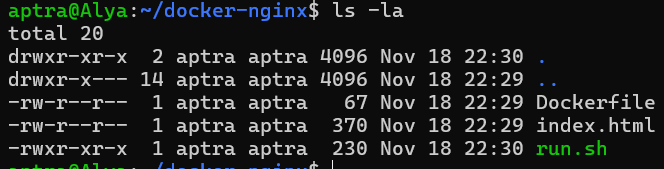
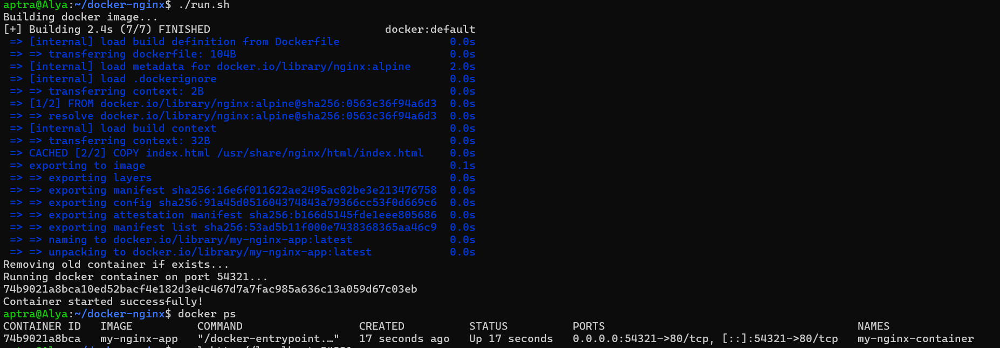
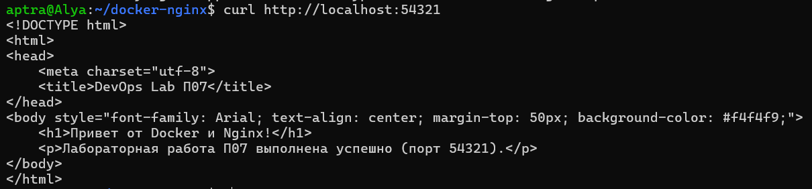

# Лабораторная работа П07: Docker basics — практика

## Цель работы

Создать собственный Docker-образ на базе `nginx:alpine` со статической HTML-страницей, выполнить проброс порта `54321` на порт `80` контейнера и автоматизировать сборку и запуск с помощью shell-скрипта в среде WSL (Ubuntu) с Docker Desktop.

## Состав проекта

- `Dockerfile` — описание сборки образа на базе `nginx:alpine` и копирование `index.html` в `/usr/share/nginx/html/index.html`.
- `index.html` — статическая HTML-страница с заголовком и сообщением об успешном выполнении работы.
- `run.sh` — исполняемый скрипт для сборки образа `my-nginx-app`, удаления старого контейнера `my-nginx-container` и запуска нового с пробросом порта `54321:80`.
- `screenshots/` — скриншоты подготовки файлов, запуска скрипта и проверки ответа сервера.

## Ход работы и проверка

1. Подготовлены файлы `Dockerfile`, `index.html` и скрипт `run.sh` (`ls -la`).
2. Запущен скрипт `./run.sh`: собран образ `my-nginx-app`, удалён предыдущий контейнер и запущен контейнер `my-nginx-container` с пробросом `0.0.0.0:54321->80/tcp` (проверено через `docker ps`).
3. Выполнена проверка доступности веб-сервера командой `curl http://localhost:54321` — получен ожидаемый HTML-код страницы.

## Скриншоты

- **Файлы проекта в каталоге:**
  

- **Сборка образа, запуск `./run.sh` и статус контейнера (`docker ps`):**
  

- **Проверка ответа веб-сервера (`curl http://localhost:54321`):**
  

## Вывод

В ходе работы освоен базовый цикл работы с Docker: создание кастомного образа на базе Nginx, публикация статического контента, настройка проброса порта `54321` и автоматизация запуска контейнера через shell-скрипт.
